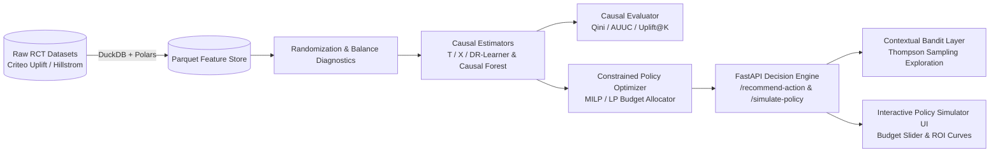

# Causal Uplift Modeling & Constrained Policy Engine

> **Status:** Project Specification / Blueprint (not yet implemented; evaluation result fields marked `TBD` until experiments are run).

An end-to-end **Causal Data Science and Decision Engineering** platform that moves beyond correlation-based churn/conversion prediction to estimate **Individual Treatment Effects (ITE / CATE)** and optimize intervention budgets under real-world business constraints.

Instead of targeting customers who would convert anyway (*Sure Things*) or never convert regardless of incentives (*Lost Causes*), the system identifies *Persuadables*, computes optimal budget-constrained promo allocations, serves real-time policy decisions via an API, and adapts online using contextual bandits.

---

## Why This Matters in Industry

Traditional ML workflows predict $P(Y = 1 \mid X)$ and target high-risk or high-propensity users. In practice, this wastes marketing budget and can even trigger negative effects (*Sleeping Dogs* who churn when contacted). Production growth, pricing, and retention teams at large marketplaces, fintechs, and SaaS companies instead estimate **uplift**:

$$\tau(x) = \mathbb{E}[Y(1) - Y(0) \mid X = x]$$

This project covers the complete lifecycle: randomized-experiment diagnostics, heterogeneous treatment effect estimation, causal evaluation, linear/integer budget optimization, counterfactual simulation, and production API serving.

---

## Architecture



Two operating paths:

1. **Offline Causal & Policy Pipeline:** Ingestion, covariate balance checks, uplift model training/validation, Qini/AUUC evaluation, and budget-constrained policy calibration.
2. **Online Decision & Simulation Service:** Real-time action recommendations (`treatment` vs `control` + expected incremental net profit + confidence interval), counterfactual policy simulation, and adaptive bandit updates.

---

## Datasets & Free Resources

All datasets, libraries, and compute requirements run **100% free on local CPU** with zero paid API or GPU dependencies.

| Resource | Details | License / Cost |
|---|---|---|
| **Kevin Hillstrom MineThatData** | 64,000 customer records across 3 arms (*Mens E-Mail*, *Womens E-Mail*, *No E-Mail*), `visit`, `conversion`, `spend` outcomes. Ideal for prototyping and multi-treatment policy optimization. | Free public benchmark (`sklift.datasets.fetch_hillstrom`) |
| **Criteo Uplift Prediction** | ~25.3M rows (`25,309,483`), 12 numerical features (`f0`-`f11`), treatment indicator, `visit` and `conversion` labels (~311-459 MB compressed, ~3.55 GB uncompressed). Processed via stratified subsampling + DuckDB/Parquet on laptop CPU. | **CC BY-NC-SA 4.0** (free for research/non-commercial portfolio use) |
| **Causal & ML Stack** | `EconML` (MIT), `scikit-uplift` (MIT), `LightGBM` (MIT), `DuckDB`, `Polars`, `scipy.optimize` / `PuLP` | 100% Open Source |
| **Serving & UI** | `FastAPI`, `Pydantic`, `Docker`, `Streamlit` or `SvelteKit` | 100% Open Source |

---

## Data Science & Statistical Methodology

### 1. Randomization & Confounding Diagnostics
- **Covariate Balance Check:** Compute Standardized Mean Difference (SMD) across all features between treatment and control groups to verify unconfoundedness / RCT integrity.
- **Overlap / Positivity Check:** Inspect estimated propensity score distributions $e(x) = P(T=1 \mid X=x)$ to guard against extreme weights.
- **Anti-Leakage Split:** Stratified split preserving treatment-control ratios across Train / Calibration / Test sets (and temporal splits where timestamps exist).

### 2. Baseline vs. Causal Models
Compare standard predictive targeting against dedicated causal estimators:
- **Naive Baseline:** Propensity/conversion classifier $P(Y=1 \mid X)$ and *Random Targeting*.
- **Meta-Learners (`EconML` + LightGBM):**
  - **S-Learner:** Single model with treatment indicator as a feature.
  - **T-Learner:** Separate outcome models $\hat{\mu}_1(x)$ and $\hat{\mu}_0(x)$.
  - **X-Learner:** Cross-imputed treatment effects suited for imbalanced treatment ratios.
  - **DR-Learner (Doubly Robust):** Combines outcome regression and inverse propensity weighting so estimates remain consistent if either nuisance model is well-specified.
- **Tree-Based Causal Estimator:** `CausalForestDML` providing asymptotic confidence intervals per user.

### 3. Causal Evaluation Metrics
Standard accuracy/ROC-AUC cannot evaluate counterfactual uplift because each user is only observed in one treatment state. Models are evaluated using:
- **Qini Curve & Qini Coefficient:** Cumulative incremental conversions gained over random targeting.
- **AUUC (Area Under Uplift Curve):** Ranking quality across treatment-effect quantiles.
- **Uplift@K (Top 10%, 20%, 30%):** Expected incremental lift when budget limits targeting to the top $K\%$ persuadable users.
- **Calibration & Refutation Checks:** Placebo treatment tests and subset stability checks.

### 4. Constrained Policy Optimization
Translate individual CATE predictions $\hat{\tau}_i$ and expected treatment cost $c_i$ into an actionable allocation policy $a_i \in \{0, 1\}$ (or multi-arm $a_{i,k}$):

$$\max_{a} \sum_{i=1}^{N} \left( v_i \cdot \hat{\tau}_i(x_i) - c_i \right) a_i \quad \text{subject to} \quad \sum_{i=1}^{N} c_i a_i \le B, \quad \sum_{i \in G_g} a_i \le Q_g$$

where $v_i$ is conversion value, $B$ is total campaign budget, and $Q_g$ enforces segment-level fairness or exposure caps.

### 5. Online Adaptation (Contextual Bandit)
Simulate sequential traffic where customer responsiveness drifts over time:
- Compare static uplift policy vs. **Thompson Sampling / LinUCB** exploration-exploitation policy.
- Measure **Cumulative Regret** and **Net Incremental Revenue** over simulated campaign horizons.

---

## AI Engineering & Serving Layer

### FastAPI Endpoints
- `POST /recommend-action`: Accepts user feature vector + campaign constraints; returns recommended arm (`treat` / `holdout`), estimated CATE with confidence bounds, expected net ROI, and explanation.
- `POST /optimize-batch`: Accepts candidate user batch + budget $B$; returns optimal allocation vector via LP/MILP solver and projected incremental conversions/profit.
- `POST /simulate-policy`: Runs counterfactual A/B simulation comparing *Random*, *Naive Propensity*, *Uplift Policy*, and *Contextual Bandit* under custom budget and cost parameters.
- `GET /health` & `GET /metrics`: Service health, model version, and distribution drift checks (PSI on incoming features vs. training baseline).

### Interactive Simulator Dashboard
- **Budget & Cost Explorer:** Adjust campaign budget and incentive cost to inspect the efficient frontier of incremental profit vs. spend.
- **Uplift & Qini Diagnostics:** Visual comparison of T/X/DR-Learner and Causal Forest curves.
- **Segment Breakdown:** Inspect proportions of *Persuadables*, *Sure Things*, *Lost Causes*, and *Sleeping Dogs*.

---

## Proposed Repository Structure

```text
causal-uplift-policy/
├── config/
│   ├── hillstrom.yaml               # Experiment config for Hillstrom dataset
│   └── criteo.yaml                  # Experiment config for Criteo subsampled runs
├── data/
│   ├── raw/                         # Downloaded datasets (gitignored)
│   └── processed/                   # Parquet datasets (gitignored)
├── notebooks/
│   ├── 01_causal_eda_balance.ipynb  # Covariate balance (SMD), overlap, exploratory plots
│   ├── 02_uplift_benchmarks.ipynb   # S/T/X/DR-Learner vs Causal Forest vs Naive baseline
│   └── 03_policy_bandit_sim.ipynb   # Budget MILP optimization & contextual bandit replay
├── src/
│   ├── data/
│   │   ├── loader.py                # DuckDB/Polars ingestion & stratified sampling
│   │   └── diagnostics.py           # SMD balance check & propensity overlap tests
│   ├── models/
│   │   ├── uplift.py                # Unified wrapper for EconML learners & baselines
│   │   ├── evaluator.py             # Qini, AUUC, Uplift@K, calibration plots
│   │   └── optimizer.py             # Budget-constrained LP/MILP allocator
│   ├── bandit/
│   │   └── simulator.py             # Counterfactual replay & Thompson Sampling policy
│   └── api/
│       ├── main.py                  # FastAPI application
│       ├── schemas.py               # Pydantic request/response contracts
│       └── drift.py                 # Feature PSI drift monitoring
├── dashboard/                       # Streamlit or SvelteKit interactive simulator
├── tests/
│   ├── test_diagnostics.py
│   ├── test_evaluator.py            # Qini/AUUC correctness assertions
│   ├── test_optimizer.py            # Budget & cap constraint tests
│   └── test_api.py                  # FastAPI endpoint & schema tests
├── Dockerfile
├── pyproject.toml
└── README.md
```

---

## Target Experiment Results (To Populate After Runs)

| Policy / Estimator | AUUC | Qini Coeff | Uplift@20% | Projected Net Profit (at Budget B) |
|---|---|---|---|---|
| Random Targeting | TBD | TBD | TBD | TBD |
| Naive Propensity Model | TBD | TBD | TBD | TBD |
| T-Learner (LightGBM) | TBD | TBD | TBD | TBD |
| X-Learner (LightGBM) | TBD | TBD | TBD | TBD |
| DR-Learner (EconML) | TBD | TBD | TBD | TBD |
| Causal Forest DML | TBD | TBD | TBD | TBD |

---

## Implementation Milestones

1. **Phase 1: Data & Causal Diagnostics:** Ingest Hillstrom (fast iteration) + Criteo Uplift subset (scale validation) into Parquet via DuckDB; implement SMD balance & overlap checks.
2. **Phase 2: Uplift Modeling & Evaluation:** Train S/T/X/DR-Learners and Causal Forest; implement Qini, AUUC, Uplift@K, and placebo refutation tests.
3. **Phase 3: Policy Optimization & Bandit Replay:** Build LP/MILP budget allocator (`scipy`/`PuLP`) and counterfactual contextual bandit simulator.
4. **Phase 4: Production Service, UI & Tests:** Wrap in FastAPI + Docker with PSI drift detection, build interactive simulator UI, write unit/integration tests, and record benchmark results.
